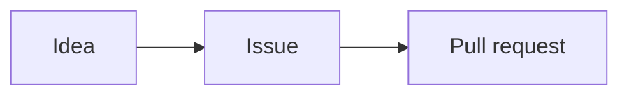

<Card id="hook" type="hook">
<Interactive name="PracticeRepo" screen="markdown-file" at="PLAN.md" repo={{ owner: 'kelab-kod', name: 'club-site', files: [{ path: 'PLAN.md', content: '# Open Day plan\n\n> [!WARNING]\n> The site must be live by Friday!\n\n## Jobs\n\n| Job | Who | Done? |\n| --- | --- | :---: |\n| Home page | Aina | Yes |\n| Events page | Mei | No |\n\n## To do\n\n- [x] Pick a date\n- [ ] Print posters\n- [ ] Test on phones\n\n## How work flows\n\n```mermaid\nflowchart LR\n  A[Idea] --> B[Issue] --> C[Pull request]\n```\n' }] }} />

The club's plan has a warning box, a table, tick boxes and a diagram. Every bit is plain text! Let's learn each trick.
</Card>

<Card id="try-tasks" type="try">
A **<Term id="task-list">task list</Term>** has tick boxes. `- [ ]` means not done. `- [x]` means done. Tick "Pick a date". Leave "Print posters" open.

<Interactive name="MarkdownPlayground" initial={'## To do\n\n- Pick a date\n- Print posters\n'} prompt="Turn both lines into tick boxes. Only Pick a date is done." goal={{ mustMatch: ['^- \\[x\\] Pick a date', '^- \\[ \\] Print posters'], hint: ['Write [x] and a space after the dash before Pick a date.', 'Write [ ] and a space after the dash before Print posters.'] }} success="Tick boxes! One done, one to go." />

<Hint>Inside the square brackets: an x for done, a space for not done.</Hint>
</Card>

<Card id="try-table" type="try">
A **table** puts pipes | between cells. One special line sits under the top row. Tap that line.

<Interactive name="SpotLines" lines={[{ text: '| Job | Who |' }, { text: '| --- | --- |', target: true }, { text: '| Home page | Aina |' }, { text: '| Events page | Mei |' }]} prompt="Tap the line that makes the top row a header." success="Yes! The dashes turn the top row into the header." />
</Card>

<Card id="try-alert" type="try">
An **<Term id="markdown-alert">alert</Term>** is a coloured box. Put `> [!WARNING]` on its own line, above the quote. The others are NOTE, TIP, IMPORTANT and CAUTION.

<Interactive name="MarkdownPlayground" initial={'> Back up your work first.\n'} prompt="Turn this quote into a warning box." goal={{ mustMatch: ['^> \\[!WARNING\\][ \\t]*\\n>[ \\t]*\\S'], hint: ['Add a new first line: > [!WARNING]. Keep the old line under it.'] }} success="A warning box! Nobody will miss that." />

<Hint>The first line is only `> [!WARNING]`. The next line starts with `>` too.</Hint>
</Card>

<Card id="predict" type="predict">
A code block marked `mermaid` becomes a diagram. What does GitHub show for this one?



<Interactive name="Choice" options={[{ label: 'Three boxes joined by arrows: Idea, Issue, Pull request', correct: true, why: 'GitHub draws Mermaid text as a picture. Each --> is an arrow.' }, { label: 'The code, just as typed', why: 'A mermaid block is special. GitHub draws it.' }, { label: 'A table with three columns', why: 'Tables use pipes. This one is a flowchart.' }]} />
</Card>

<Card id="check-sort" type="check">
Which trick is which? Sort each line.

<Interactive name="SortCards" buckets={[{ id: 'task', label: 'Task list' }, { id: 'table', label: 'Table' }, { id: 'alert', label: 'Alert' }]} items={[{ label: '`- [ ] Print posters`', bucket: 'task', why: 'A dash and square brackets make a tick box.' }, { label: '`| Job | Who |`', bucket: 'table', why: 'Pipes split the cells.' }, { label: '`> [!NOTE]`', bucket: 'alert', why: 'A quote with [!NOTE] is a blue note box.' }, { label: '`- [x] Pick a date`', bucket: 'task', why: 'The x means done.' }, { label: '`| --- | --- |`', bucket: 'table', why: 'This line sits under the header row.' }, { label: '`> [!TIP]`', bucket: 'alert', why: 'TIP makes a box for helpful advice.' }]} success="Four new tricks in your bag!" />
</Card>

<Card id="win" type="win">
You can now add tick boxes, tables, alert boxes and diagrams to Markdown.
</Card>

<Card id="deeper" type="deeper">
Colons in the dash line align a column: `:---` left, `:---:` centre, `---:` right. NOTE is for useful extras. WARNING is for urgent things. CAUTION warns about risky results. Mermaid can also draw sequence diagrams and pie charts. GitHub can draw maps (`geojson`) and 3D models (`stl`) too.
</Card>
