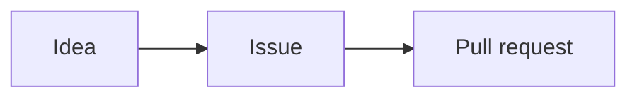

<Card id="hook" type="hook">
<Interactive name="PracticeRepo" screen="markdown-file" at="PLAN.md" repo={{ owner: 'kelab-kod', name: 'club-site', files: [{ path: 'PLAN.md', content: '# Pelan Hari Terbuka\n\n> [!WARNING]\n> Laman mesti siap sebelum Jumaat!\n\n## Tugas\n\n| Tugas | Siapa | Siap? |\n| --- | --- | :---: |\n| Halaman utama | Aina | Ya |\n| Halaman acara | Mei | Belum |\n\n## Senarai tugas\n\n- [x] Pilih tarikh\n- [ ] Cetak poster\n- [ ] Uji di telefon\n\n## Aliran kerja\n\n```mermaid\nflowchart LR\n  A[Idea] --> B[Issue] --> C[Pull request]\n```\n' }] }} />

Pelan kelab ini ada kotak amaran, jadual, kotak tanda dan rajah. Semuanya teks biasa! Jom belajar setiap helah.
</Card>

<Card id="try-tasks" type="try">
**<Term id="task-list">Senarai tugas</Term>** (task list) ada kotak tanda. `- [ ]` maksudnya belum siap. `- [x]` maksudnya siap. Tandakan "Pilih tarikh". Biarkan "Cetak poster" terbuka.

<Interactive name="MarkdownPlayground" initial={'## Senarai tugas\n\n- Pilih tarikh\n- Cetak poster\n'} prompt="Tukar dua baris itu jadi kotak tanda. Hanya Pilih tarikh yang siap." goal={{ mustMatch: ['^- \\[x\\] Pilih tarikh', '^- \\[ \\] Cetak poster'], hint: ['Tulis [x] dan satu jarak selepas sengkang, sebelum Pilih tarikh.', 'Tulis [ ] dan satu jarak selepas sengkang, sebelum Cetak poster.'] }} success="Kotak tanda! Satu siap, satu lagi menunggu." />

<Hint>Dalam kurungan segi empat: x untuk siap, jarak untuk belum siap.</Hint>
</Card>

<Card id="try-table" type="try">
**Jadual** letak garis tegak | antara sel. Satu baris istimewa duduk di bawah baris atas. Tekan baris itu.

<Interactive name="SpotLines" lines={[{ text: '| Tugas | Siapa |' }, { text: '| --- | --- |', target: true }, { text: '| Halaman utama | Aina |' }, { text: '| Halaman acara | Mei |' }]} prompt="Tekan baris yang jadikan baris atas sebagai kepala jadual." success="Betul! Sengkang itu jadikan baris atas sebagai kepala jadual." />
</Card>

<Card id="try-alert" type="try">
**<Term id="markdown-alert">Amaran</Term>** (alert) ialah kotak berwarna. Letak `> [!WARNING]` pada baris sendiri, di atas petikan. Yang lain ialah NOTE, TIP, IMPORTANT dan CAUTION.

<Interactive name="MarkdownPlayground" initial={'> Buat salinan kerja anda dulu.\n'} prompt="Tukar petikan ini jadi kotak amaran." goal={{ mustMatch: ['^> \\[!WARNING\\][ \\t]*\\n>[ \\t]*\\S'], hint: ['Tambah baris pertama yang baru: > [!WARNING]. Simpan baris lama di bawahnya.'] }} success="Kotak amaran! Tiada siapa akan terlepas pandang." />

<Hint>Baris pertama hanya `> [!WARNING]`. Baris seterusnya pun bermula dengan `>`.</Hint>
</Card>

<Card id="predict" type="predict">
Blok kod bertanda `mermaid` jadi rajah. Apa yang GitHub tunjuk untuk blok ini?



<Interactive name="Choice" options={[{ label: 'Tiga kotak bersambung dengan anak panah: Idea, Issue, Pull request', correct: true, why: 'GitHub lukis teks Mermaid jadi gambar. Setiap --> ialah anak panah.' }, { label: 'Kod itu, sama macam yang ditaip', why: 'Blok mermaid ini istimewa. GitHub lukis ia.' }, { label: 'Jadual dengan tiga lajur', why: 'Jadual guna garis tegak. Ini carta alir.' }]} />
</Card>

<Card id="check-sort" type="check">
Helah mana yang mana? Susun setiap baris.

<Interactive name="SortCards" buckets={[{ id: 'task', label: 'Senarai tugas' }, { id: 'table', label: 'Jadual' }, { id: 'alert', label: 'Amaran' }]} items={[{ label: '`- [ ] Cetak poster`', bucket: 'task', why: 'Sengkang dan kurungan segi empat buat kotak tanda.' }, { label: '`| Tugas | Siapa |`', bucket: 'table', why: 'Garis tegak pisahkan sel.' }, { label: '`> [!NOTE]`', bucket: 'alert', why: 'Petikan dengan [!NOTE] jadi kotak nota biru.' }, { label: '`- [x] Pilih tarikh`', bucket: 'task', why: 'Huruf x maksudnya siap.' }, { label: '`| --- | --- |`', bucket: 'table', why: 'Baris ini duduk di bawah baris kepala.' }, { label: '`> [!TIP]`', bucket: 'alert', why: 'TIP buat kotak untuk nasihat berguna.' }]} success="Empat helah baru dalam beg anda!" />
</Card>

<Card id="win" type="win">
Kini anda boleh tambah kotak tanda, jadual, kotak amaran dan rajah dalam Markdown.
</Card>

<Card id="deeper" type="deeper">
Titik bertindih dalam baris sengkang susun lajur: `:---` kiri, `:---:` tengah, `---:` kanan. NOTE untuk info tambahan. WARNING untuk perkara mendesak. CAUTION beri amaran tentang akibat berisiko. Mermaid juga boleh lukis rajah jujukan dan carta pai. GitHub boleh lukis peta (`geojson`) dan model 3D (`stl`) juga.
</Card>
